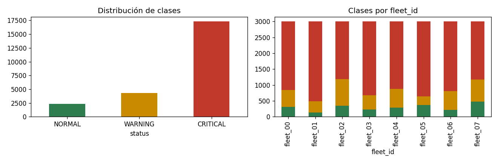
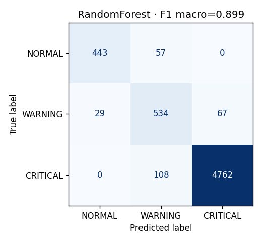

# ACI606 · Ejercicio 4 · Cloud Fleet Challenge

**URL pública del servicio:** https://github.com/jssberroeta-tech/aci606-cloud-fleet.git
(documentación interactiva: `/docs` · panel del operador: `/dashboard`)

**Integrantes:** [Jesús Berroeta, Diego Castillo y Franco Muñoz]

## Resumen

Servicio FastAPI que recibe telemetría de una flota virtual de robots, la guarda en PostgreSQL, predice la condición de cada robot (NORMAL, WARNING o CRITICAL) con un modelo de scikit-learn y expone métricas operacionales y un panel web.

## Plataforma y ubicación de los datos

| Componente | Servicio | Detalle |
|---|---|---|
| API | Render (Web Service, plan gratuito) | FastAPI + Uvicorn, URL pública HTTPS |
| Base de datos | Neon (PostgreSQL gestionado) | Tablas `telemetry` y `predictions`; los datos persisten ante reinicios |
| Modelo | Repositorio Git | `models/model.joblib` y `models/model_meta.json` |
| Despliegue | GitHub → Render | Despliegue automático en cada push a `main` |

Los datos de telemetría y predicciones están en la base de datos de Neon, no en el disco de Render (que es efímero). La cadena de conexión se entrega como variable de entorno y nunca se guarda en el repositorio.

## Procedimiento de despliegue

1. Crear un proyecto en Neon y copiar la cadena de conexión.
2. Subir el repositorio a GitHub (rama `main`).
3. En Render: New → Web Service y conectar el repositorio.
4. Build Command: `pip install -r requirements.txt`
5. Start Command: `uvicorn app.main:app --host 0.0.0.0 --port $PORT`
6. Variables de entorno: `DATABASE_URL` (cadena de Neon) y `MODEL_PATH=models/model.joblib`. La versión de Python se fija con el archivo `.python-version` (3.13).
7. Verificar: `GET /health`, smoke test contra la URL pública y prueba de reinicio (el historial en `/robots/{id}/history` debe conservarse).

## Variables de entorno

| Variable | Uso |
|---|---|
| `DATABASE_URL` | Cadena de conexión a PostgreSQL (Neon). Sin ella, el servicio usa SQLite local. |
| `MODEL_PATH` | Ruta del modelo (`models/model.joblib`). |

## Rutas de la API

| Ruta | Función |
|---|---|
| `GET /health` | Estado del servicio, la base de datos y el modelo |
| `POST /telemetry` | Ingesta de una muestra (la guarda junto con su predicción) |
| `GET /robots` | Última muestra por robot |
| `GET /robots/{id}/history` | Historial completo (opcional: `?limit=N` para las últimas N) |
| `POST /predict` | Condición predicha |
| `GET /metrics` | Solicitudes, errores, latencia (P50/P95/P99) y uptime |
| `GET /dashboard` | Panel del operador |

Los datos inválidos (campo faltante, fuera de rango, NaN) responden 422, nunca 5xx.

Ejemplo de respuesta de `POST /predict`:

```json
{"robot_id": "R03", "predicted_status": "WARNING", "confidence": 0.87, "model_version": "v1", "inference_ms": 12.4}
```

## Evidencia del modelo

**Datos y validación**

- Dataset: 24.000 muestras de 8 flotas (3.000 por flota; una flota por archivo en `data/`).
- Distribución de clases: CRITICAL 72,1 % · WARNING 18,0 % · NORMAL 9,9 %.
- Variables (6): `speed`, `battery`, `motor_temp`, `vibration`, `motor_current`, `obstacle_distance`.
- Separación entrenamiento/prueba con `GroupShuffleSplit` por `fleet_id` (25 %): el conjunto de prueba son 2 flotas que el modelo nunca vio.
- Selección del modelo con validación cruzada `GroupKFold` sobre las flotas de entrenamiento, sin usar el conjunto de prueba.

**Comparación de clasificadores**

| Modelo | F1 macro (validación cruzada por flota) |
|---|---|
| Random Forest (300 árboles, `class_weight=balanced_subsample`) | **0,9206** |
| Gradient Boosting (250 árboles, `learning_rate=0,08`, `max_depth=3`) | 0,9180 |

**Resultado en flotas no vistas (Random Forest)**

| Métrica | Valor |
|---|---|
| F1 macro | **0,899** |
| Línea base (clase mayoritaria) | 0,2987 |
| Accuracy | ≈ 95,7 % |
| F1 NORMAL / WARNING / CRITICAL | 0,912 / 0,804 / 0,982 |

F1_macro = (1/K) · Σ F1_k, con F1_k = 2·P_k·R_k / (P_k + R_k) y K = 3. Como CRITICAL es el 72 % de las muestras, la accuracy por sí sola engaña; el F1 macro exige buen desempeño en las tres clases.

**Matriz de confusión** (filas = real, columnas = predicho)

| | NORMAL | WARNING | CRITICAL |
|---|---|---|---|
| **NORMAL** | 443 | 57 | 0 |
| **WARNING** | 29 | 534 | 67 |
| **CRITICAL** | 0 | 108 | 4.762 |

Los errores ocurren entre clases vecinas; no hay confusiones entre NORMAL y CRITICAL.




**Justificación técnica:** se eligió Random Forest por su mayor F1 macro en validación cruzada por flota (diferencia pequeña respecto de Gradient Boosting), por su robustez y por ser simple de operar. El pipeline completo (imputación, escalado y clasificador) se guarda en `models/model.joblib`, junto con `models/model_meta.json` (versión, variables, métricas y versiones de las librerías). El modelo desplegado se reentrenó con todas las flotas; las métricas anteriores son las de la separación por flota.

## Ejecución local

```powershell
py -3.13 -m venv .venv
.\.venv\Scripts\Activate.ps1
python -m pip install -r requirements.txt
python -m uvicorn app.main:app --port 8000
```

Sin `DATABASE_URL`, el servicio usa SQLite local (`fleet.db`).

Simulador y smoke test:

```powershell
python simulator\fleet_simulator.py --api http://127.0.0.1:8000 --robots 5 --interval 0.5 --steps 200
python tests\smoke_test.py --api http://127.0.0.1:8000
```

Reentrenar el modelo (requiere `requirements-train.txt`):

```powershell
python -m pip install -r requirements-train.txt
python train_model.py
```

## Trazabilidad en Git

Desarrollo en la rama `feature/cloud-service` con commits por componente (base de datos, modelo, API y documentación), integrada en `main` mediante merge.

## Limitaciones conocidas

- Los datos son simulados.
- Las métricas operacionales viven en memoria y se reinician con el servicio.
- Las tablas se crean con `create_all`, sin migraciones.
- No hay autenticación.